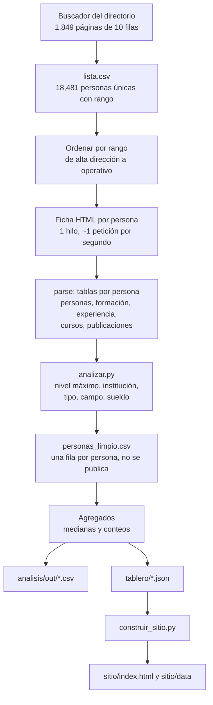
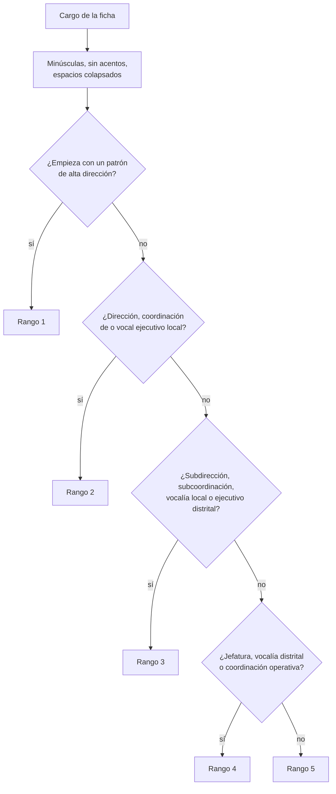
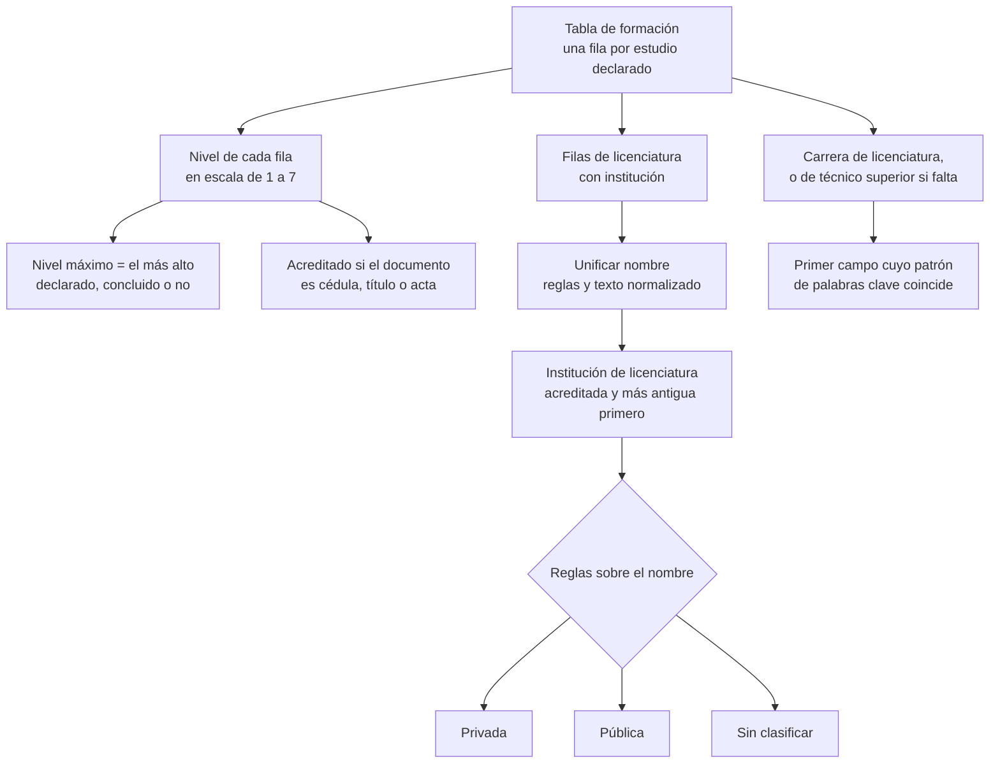
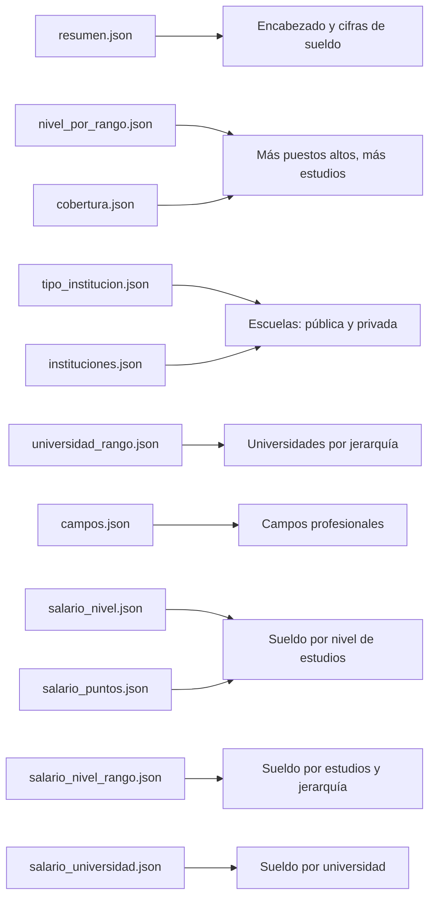

# Estudios y salarios en el INE

Análisis agregado del personal del Instituto Nacional Electoral a partir de su directorio público: qué estudiaron, dónde, y cuánto ganan según su puesto.

Sitio: <https://jmtoral.github.io/mandarines/>

Este repositorio publica **solo cifras agregadas** (conteos y medianas). No contiene nombres, fichas individuales ni tablas por persona.

## Contenido

1. [Fuente de datos](#fuente-de-datos)
2. [Cómo se obtuvo](#cómo-se-obtuvo)
3. [Jerarquía en cinco rangos](#jerarquía-en-cinco-rangos)
4. [Estudios: nivel máximo, institución, tipo y campo](#estudios-nivel-máximo-institución-tipo-y-campo)
5. [Sueldo y umbrales](#sueldo-y-umbrales)
6. [Qué alimenta cada sección del sitio](#qué-alimenta-cada-sección-del-sitio)
7. [Hallazgos principales](#hallazgos-principales)
8. [Limitaciones](#limitaciones)
9. [Qué no se publica y por qué](#qué-no-se-publica-y-por-qué)
10. [Estructura del repositorio](#estructura-del-repositorio)

## Fuente de datos

El [Directorio de Personal del INE](https://directorio.ine.mx/) es público. Cada persona tiene una ficha con:

- grado y nombre, cargo, área de adscripción y entidad federativa;
- nivel del puesto, clave del puesto, total de percepciones brutas y total neto mensual;
- fecha de última actualización de la ficha;
- cuatro secciones de currículum, autodeclaradas: formación académica, experiencia, cursos y publicaciones.

En la formación cada fila trae nivel o grado académico, periodo, documento obtenido, institución y nombre de la carrera, todo en texto libre.

La foto se tomó el **10 y 11 de noviembre de 2026** y cubre **18,481 fichas**. Es una imagen de un momento: el directorio cambia.

## Cómo se obtuvo

La obtención está en `ine_directorio.py` y tiene tres pasos separados. Solo los dos primeros usan la red; el tercero trabaja sobre archivos guardados.

1. **Listado paginado.** Se recorre el buscador del directorio sin filtros, de página en página, hasta que una página sale vacía (se confirma una segunda vez tras esperar). Fueron 1,849 páginas de 10 filas, 18,484 filas. Antes de empezar se hace una consulta de control con un resultado conocido; si no coincide, el programa se detiene. El avance se guarda página por página, así que se puede reanudar. Una persona puede aparecer con dos plazas: se queda la de mejor rango, y quedan 18,481 personas únicas.
2. **Fichas en orden de jerarquía.** Se ordena a las personas por rango, de la alta dirección al personal operativo, y se baja el HTML de cada ficha. Las fichas ya guardadas no se piden otra vez, y una respuesta sin datos de la persona no se guarda.
3. **Análisis sin conexión.** Las fichas guardadas se convierten en tablas (`parse`): personas, formación, experiencia, cursos y publicaciones. Todo el análisis posterior parte de esas tablas.

Cortesía con el sitio: un solo hilo, como máximo una petición por segundo (espera mínima de 1.05 s entre peticiones), tiempo límite de 30 s, tres reintentos con espera creciente, y paro inmediato ante un 403 o 429 o tras cinco errores seguidos. Las peticiones se hacen con un User-Agent de navegador común.



## Jerarquía en cinco rangos

El directorio no trae una jerarquía explícita, así que se asigna por palabras clave del **cargo**. El texto del cargo se pasa a minúsculas y sin acentos, y se prueban los patrones en orden del rango 1 al 4. Gana el primero que coincide **al inicio** del cargo; si ninguno coincide, es rango 5.

| Rango | Nombre en el sitio | Patrones que lo definen (al inicio del cargo) | Personas |
|---|---|---|---|
| 1 | Alta dirección | consejería electoral o presidencia del consejo, secretaría ejecutiva, dirección ejecutiva o general, titular de unidad u órgano interno de control, coordinación general, dirección de unidad técnica | 25 |
| 2 | Direcciones y coordinaciones | vocal ejecutivo de junta local, cualquier otra dirección, coordinación de, del o de la | 158 |
| 3 | Subdirecciones y vocalías | subdirección, subcoordinación, vocalías de junta local, coordinación administrativa de junta local, vocal ejecutivo de junta distrital | 717 |
| 4 | Jefaturas y vocalías distritales | jefaturas, vocalías de junta distrital, coordinación operativa o administrativa | 2,331 |
| 5 | Personal operativo | todo lo demás | 15,250 |



El código tiene una prueba (`python ine_directorio.py --selftest`) con 19 cargos de ejemplo y dos fichas completas. Aun así, es una regla por palabras clave, no un catálogo oficial de puestos (ver [Limitaciones](#limitaciones)).

## Estudios: nivel máximo, institución, tipo y campo

Todo está en `analisis/analizar.py`. Se parte de la tabla de formación (19,115 filas, 12,898 personas con al menos una).

**Nivel máximo de estudios.** Los niveles declarados se ordenan: secundaria, bachillerato, técnico superior, licenciatura, especialidad, maestría y doctorado. El nivel máximo de una persona es el más alto que aparece en alguna fila, **lo haya concluido o no**. Además se marca si ese nivel está *acreditado*: cuenta como acreditación una cédula profesional, título, acta de grado o acta de examen; un certificado de estudios solo en secundaria y bachillerato; un diploma solo en especialidad. Una carta de pasante, constancia, boleta o historial no acreditan. El sitio no usa esa marca para filtrar.

**Institución de licenciatura.** El nombre viene en texto libre, así que se unifica: se normaliza el texto, se quitan sufijos como «A. C.», se recorta lo que sigue a «campus», «unidad», «plantel», «facultad», etc. en nombres largos que empiezan con «universidad» o «instituto», y una lista de reglas manuales agrupa los casos conocidos (por ejemplo, las facultades de la UNAM y el Tec de Monterrey). Los demás nombres se agrupan por texto normalizado y toman el nombre más frecuente. Quedan 1,426 instituciones distintas entre las 9,394 personas con institución de licenciatura declarada. Si una persona tiene varias filas de licenciatura se toma, con preferencia, una acreditada y, a igualdad, la más antigua.

**Pública o privada.** No hay una fuente externa: es una lista de reglas sobre el nombre. Primero se prueban patrones de privadas (porque «autónoma» engaña: hay privadas con ese nombre), después de públicas, y lo que no encaja queda como «Sin clasificar». La clasificación cubre **85.4 %** de las instituciones declaradas (objetivo fijado: 85 %); **14.6 %** (1,375 personas) quedó sin clasificar.

**Campo profesional.** Se toma la carrera de la licenciatura, o la del técnico superior si no hay licenciatura, y se asigna el primer campo cuyo patrón de palabras clave coincida (derecho, informática y sistemas, administración, contaduría, etc.; 21 categorías incluidas «Otros» y «Sin clasificar»). Se prefiere la licenciatura sobre el técnico superior, una carrera que se pueda clasificar, una acreditada, y la más antigua. Se clasificó el **98.7 %** de las 9,755 personas con licenciatura o técnico superior (objetivo fijado: 92 %).



## Sueldo y umbrales

- **Sueldo:** la percepción **bruta mensual** del puesto (la fila «Total percepciones» de la ficha). No se usa el neto. Cinco personas no tienen sueldo legible y quedan fuera de las medianas.
- **Estadísticos:** siempre **mediana** y cuartiles (p25 y p75). La media se distorsiona con los puestos altos. Los sueldos están en tabuladores, así que las medianas se repiten con frecuencia.
- **Quién cuenta en los porcentajes de estudios:** solo quien declaró formación (12,898 personas, 69.8 %). Quien no la declaró aparece como «Sin currículum» en el sueldo por nivel.
- **Umbrales:**
  - Sueldo por universidad: instituciones con **al menos 30 personas** con licenciatura declarada (48 instituciones). La mediana dentro del rango 5 y la del rango 4 se calculan en cada una y la tabla marca en cursiva las que tienen menos de 10 personas en ese rango.
  - Universidades por jerarquía (treemap): en la **alta dirección (rango 1)** se listan **todas** las instituciones, aunque sea una sola persona; en el rango 2, las que tienen **al menos 2 personas**; en los rangos 3 a 5, **al menos 5**. En los rangos 2 a 5 el resto se junta en «Otras instituciones», de modo que la suma de cada rango es el total con licenciatura declarada. En ningún rango se publica la mediana de sueldo de una institución con **menos de 3 personas**: con una o dos personas esa cifra sería el sueldo de alguien identificable, así que la tabla de datos trae `null` y el tooltip dice «Sueldo no mostrado (menos de 3 personas)».
  - Sueldo por nivel de estudios dentro de cada jerarquía: combinaciones con **al menos 10 personas**.
  - Instituciones más frecuentes: las 30 con más egresados en el análisis; el sitio muestra las 15 primeras.

  - Puntos de la gráfica de sueldo por nivel de estudios: `salario_puntos.json` tiene una fila por cada **sueldo distinto** dentro de cada nivel máximo de estudios, con el número de personas que lo cobran (821 filas; 18,476 personas con sueldo legible). Cada círculo es una de esas filas y su área es proporcional a las personas. La escala horizontal es logarítmica. No lleva nombre, jerarquía ni institución, pero los valores que cobra una sola persona sí aparecen: es lo que permite ver los extremos.

## Qué alimenta cada sección del sitio



Los 11 JSON agregados están en [`data/`](data/) para descargarlos. Cada uno es un arreglo de filas.

## Hallazgos principales

Todas las cifras salen de los JSON de `data/`.

**Quién declaró estudios.** De 18,481 personas, 12,898 (69.8 %) declararon formación. Entre ellas, 74.4 % tiene licenciatura o más y 15.2 % un posgrado. La cobertura es muy desigual: 92 % en alta dirección, 75.3 % en direcciones, 94.6 % y 95.2 % en subdirecciones y jefaturas, pero solo 64.7 % en el personal operativo.

**Más puesto, más estudios.** En alta dirección, 56.5 % de quienes declararon tiene maestría y 17.4 % doctorado; en el personal operativo, la licenciatura es el nivel máximo más común (58.4 %) y el bachillerato pesa mucho más que en los demás niveles (28.7 %).

**Sueldo por nivel de estudios.** La mediana del sueldo bruto mensual es de $19,599 para todo el personal. Sin licenciatura es de $15,351, con licenciatura $20,381 y con posgrado $62,412. Por nivel: bachillerato $14,141, especialidad $41,262, maestría $62,412, doctorado $97,466.

**Pero el puesto lo explica casi todo.** Dentro de una misma jerarquía, el título casi no mueve el sueldo. En el rango 3, la mediana es de $98,710 con licenciatura, $98,737 con maestría y $98,778 con doctorado. En el rango 4 es de $62,412 con licenciatura y $62,634 con maestría. Solo en el personal operativo hay diferencias claras: $14,141 con bachillerato, $15,351 con licenciatura y $26,903 con maestría (el doctorado, $103,673, son solo 23 personas).

**Dónde estudiaron.** La UNAM es la institución más común: 1,158 personas, 12.3 % de quienes declararon licenciatura, 194 de ellas en mandos (rangos 1 a 3). Siguen la Universidad de Guadalajara (305), la Universidad Veracruzana (277), el IPN (256), la UAM (253) y la BUAP (240). Entre quienes tienen institución declarada, 69.8 % estudió en una institución pública, 15.6 % en una privada y 14.6 % quedó sin clasificar; las medianas son parecidas ($23,992 en públicas y $22,899 en privadas).

**El peso de la UNAM crece con la jerarquía.** Aporta 45.0 % de la alta dirección, 29.2 % de las direcciones, 24.1 % de las subdirecciones, 17.1 % de las jefaturas y 9.2 % del personal operativo (de quienes declararon licenciatura).

**Sueldo por universidad.** Entre las 48 universidades con al menos 30 personas, la mediana general va de $14,141 a $62,634. Ese rango refleja sobre todo cuántos mandos tiene cada una. Si se mira solo al personal operativo y a las 47 instituciones con al menos 10 personas en ese nivel, la mediana va de $12,622 a $27,567.

**Campos.** Derecho es el campo más común (2,212 personas, 22.7 % de quienes tienen licenciatura o técnico superior), seguido de informática y sistemas (1,786) y administración (1,160). Las medianas más altas son las de relaciones internacionales ($48,655, 74 personas) y economía ($37,578, 166 personas); las más bajas, turismo y gastronomía ($13,148, 62 personas) y educación ($15,351). Parte de esa diferencia es de puestos, no de la carrera.

## Limitaciones

- **Los datos son autodeclarados.** Cada persona llena su ficha. 30.2 % del personal no declaró formación, sobre todo en el nivel operativo, y no se sabe si es por omisión o por falta de estudios.
- **El nivel máximo cuenta estudios no concluidos.** Se toma el nivel más alto que aparece, aunque no se haya obtenido el grado.
- **Hay errores en lo declarado.** Algunas personas anotaron cursos de capacitación como posgrado, y como institución un examen o un acuerdo oficial. No se corrigieron.
- **La jerarquía es una regla por palabras clave**, no un tabulador oficial. Sus pruebas automáticas son pocas (19 cargos). La clasificación de los rangos 3 a 5 no se auditó manualmente cargo por cargo.
- **Pública o privada no tiene fuente externa.** Son reglas sobre el nombre más una lista manual. Una de cada siete personas con institución declarada quedó sin clasificar.
- **Las instituciones se unificaron por texto.** Hay variantes que pudieron quedar separadas o campus de una misma universidad que se agruparon.
- **Foto de un momento.** El directorio es del 10 y 11 de noviembre de 2026 y no dice nada sobre trayectorias en el tiempo.
- **Nada de esto es causal.** El sueldo lo fija el puesto, no la escuela ni el título. Las cifras describen quién ocupa qué puesto, no cuánto «paga» una universidad o un grado. Con pocas personas por celda (la tabla marca los casos de menos de 10) las medianas se mueven mucho.

## Qué no se publica y por qué

Aquí solo hay agregados: conteos y medianas por institución, nivel, campo y jerarquía. **No se publica** ningún nombre, número de empleado, ficha individual ni tabla con una fila por persona, aunque el directorio de origen sea público. Una cosa es que cada ficha esté disponible para consulta y otra es reunir en un archivo descargable a 18,481 personas con su sueldo y sus estudios; el análisis busca describir la composición del personal, no señalar a nadie. Por la misma razón las tablas y el treemap de los rangos 2 a 5 agrupan las instituciones con pocas personas en «Otras instituciones», y ninguna mediana de sueldo se publica con menos de 3 personas. La excepción es la alta dirección, donde el treemap desagrega todas las instituciones: ahí solo se publica cuántas personas estudiaron en cada una (y el sueldo únicamente cuando son 3 o más), nunca el sueldo de una persona.

## Estructura del repositorio

```
index.html      página autónoma (d3 7.9.0 desde cdnjs, datos incrustados)
data/*.json     los 11 JSON agregados
.nojekyll
README.md       este archivo
```

El código de obtención y análisis que se describe arriba (`ine_directorio.py`, `analisis/analizar.py`, `analisis/salario_universidad.py`, `analisis/construir_sitio.py`) no está en este repositorio por ahora. Tampoco, por contener datos por persona, el listado, las fichas HTML, las tablas por persona ni `personas_limpio.csv`.
